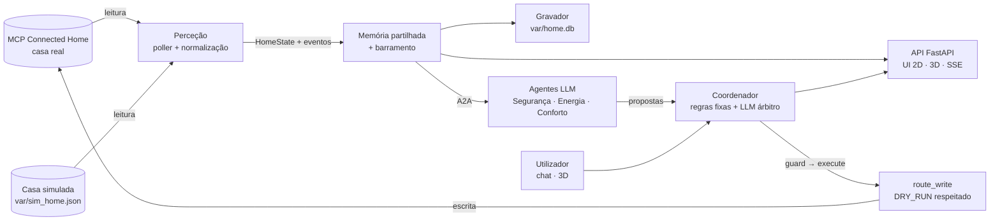

# Tico&Tech — a casa que se configura a conversar

Repositório oficial da **Equipa 7 — Tico&Tech** no **Aveiro City Hackathon 2026** (desafio ATC / Connected Home).

> Uma casa que se configura a conversar, decide contigo e aprende as tuas regras.

O utilizador fala com **um só interlocutor**, o Coordenador. Por trás, três agentes LLM especialistas
(**Segurança**, **Energia**, **Conforto**) observam a casa real através do MCP Connected Home, propõem ações,
e o Coordenador decide, explica e pede aprovação quando é preciso. Tudo aparece numa **casa em 3D** em tempo real.

---

## Índice

- [O que faz](#o-que-faz)
- [Arquitetura em 1 minuto](#arquitetura-em-1-minuto)
- [Arranque rápido](#arranque-rápido)
- [Modos de execução](#modos-de-execução)
- [Páginas da aplicação](#páginas-da-aplicação)
- [Estrutura do repositório](#estrutura-do-repositório)
- [Testes](#testes)
- [Documentação](#documentação)
- [Princípios de segurança](#princípios-de-segurança)

---

## O que faz

| Funcionalidade | Resumo |
|---|---|
| **Chat com o Coordenador** | Perguntas de estado respondidas com dados reais, preferências ("quero o quarto a 21 °C de manhã"), regras ("se abrir a janela com o aquecedor ligado, avisa-me"), comandos diretos e vários pedidos numa só mensagem. Nada é gravado nem enviado sem confirmação. |
| **Agentes por A2A** | Segurança, Energia e Conforto (Microsoft Agent Framework) recebem os eventos relevantes e devolvem propostas em JSON. O Coordenador LLM aprova ou recusa cada uma com um motivo. |
| **Regras fixas e emergência** | Guardrails em código antes e depois do LLM. **Fumo** → desliga as tomadas, luz vermelha. **Intrusão** → luz vermelha no máximo, reposta quando o alarme é cancelado. Sem LLM no caminho de emergência. |
| **Autonomia por categoria** | `energia`, `conforto`, `seguranca`, `luz`: `auto`, `perguntar` (omissão) ou `nunca`. Após 3 aprovações seguidas (ou "faz sempre assim") a casa pergunta se passa a agir sozinha. |
| **Sugestões proativas** | Padrões detetados em código sobre o histórico real (humidade à noite, janela aberta com aquecedor, standby…). O LLM só redige a frase, que é verificada contra a evidência. Máximo 2 por dia; **Porquê?** mostra o gráfico. |
| **Casa em 3D** | Three.js (local, sem internet), Server-Sent Events, balões de decisão por dispositivo, edição da planta por chat ou por arrasto. |
| **Câmara e visão** | Stream RTSP ao vivo e análise de frames por um modelo multimodal quando há eventos relevantes. |
| **"O que a casa sabe de ti"** | Ver, editar, revogar e apagar tudo o que a casa guardou sobre o utilizador (RGPD). |
| **Modo de cenários** | Reproduz os vídeos do pitch de forma determinística, sem casa real e sem LLM. |

## Arquitetura em 1 minuto



- **Só o Coordenador escreve na casa**, sempre por `guard()` → `execute()` → `route_write()`.
- Os agentes só **propõem**; as ferramentas deles são `GET` de leitura à API.
- A perceção nunca chama o LLM; os agentes só acordam com eventos relevantes.

Detalhe completo em [docs/arquitetura.md](docs/arquitetura.md).

## Arranque rápido

**Requisitos:** Python 3.12, Windows/macOS/Linux. Para a casa real: conta no MCP Connected Home. Para os agentes:
um endpoint LLM compatível com a API da OpenAI (a equipa usa `qwen3.8:latest`).

```bash
python -m venv .venv
.venv\Scripts\activate                     # Windows  (Linux/macOS: source .venv/bin/activate)
pip install -r requirements.txt -r requirements-dev.txt
cp .env.example .env                       # preencher chaves e URLs (nunca fazer commit do .env)
```

Primeira utilização com a casa real (OAuth, uma vez):

```bash
python scripts/connected_home_auth.py login
```

Arrancar:

```bash
python -m src.api --sim --agents           # tudo simulado + agentes  → http://127.0.0.1:8000/twin
python -m src.api --agents                 # casa real + agentes
python -m src.api --cenarios               # modo de cenários do pitch (sem casa, sem LLM)
```

Em Windows há atalhos em PowerShell:

```powershell
.\scripts\run.ps1 -Reset -Open             # casa simulada + agentes, abre o browser
.\scripts\sim.ps1 janela                   # corre um cenário no simulador
.\scripts\stop.ps1                         # liberta as portas 8000 e 9100–9103
```

## Modos de execução

| Comando / variável | Casa | Escritas | Uso |
|---|---|---|---|
| `python -m src.api` | MCP real | só com `DRY_RUN=false` | Produção / demo ao vivo |
| `python -m src.api --sim` (`SIMULATE=true`) | tudo simulado | nunca vão para o MCP | Desenvolvimento e testes |
| `SIM_ROOMS=true` | MCP real + divisões simuladas de `config/home.json` | só nas reais, com `DRY_RUN=false` | Ensaiar divisões que não existem |
| `--agents` | — | — | Arranca também os servidores A2A num processo filho |
| `python -m src.agents` | — | nunca | Só os servidores A2A (portas 9100–9103) |
| `python -m src.api --cenarios` | mock do MCP | só no mock | Vídeos do pitch, determinístico |
| `python -m src.perception [--sim]` | — | nunca | Só perceção, imprime eventos |
| `python -m src.storage.recorder` | MCP real | nunca | Grava histórico (deixar a correr à noite) |

`DRY_RUN=true` (omissão no `.env.example`) faz o Coordenador **só registar** as decisões. A UI mostra sempre o modo
no cabeçalho (MCP real · atua / dry-run).

Todas as variáveis estão em [docs/configuracao.md](docs/configuracao.md).

## Páginas da aplicação

| URL | O quê |
|---|---|
| `http://127.0.0.1:8000/` | Visão geral 2D: um cartão por divisão |
| `/twin` | Casa em 3D + chat com o Coordenador + linha do tempo |
| `/conhecimento` | "O que a casa sabe de ti" |
| `/simulador` | Painel do simulador (sensores, alarme, cenários) — fora da navegação |
| `/docs` | Swagger da API (FastAPI) |

Referência dos endpoints: [docs/api.md](docs/api.md).

## Estrutura do repositório

```
config/              home.json (divisões e parâmetros), layout.json (3D), layout_cenarios.json
docs/                documentação; capabilities/ = dumps reais do MCP (só leitura, sem segredos)
scripts/             CLI do MCP, OAuth, simulador, layout 3D, seed de histórico, launchers .ps1
src/
  api.py             FastAPI: API REST, SSE e UI
  coordinator.py     o único que escreve na casa (guard → execute)
  writes.py          route_write: MCP ou simulador, dry-run
  agents/            servidores A2A, especificação dos agentes, ponte do Coordenador, ferramentas
  chat/              intenções (LLM + regras PT-PT), respostas, regras → cenários MCP, serviço do chat
  perception/        fontes (MCP/sim), poller, normalização e diff em eventos
  storage/           SQLite: leituras, eventos, decisões, gravador
  prefs/             preferências versionadas e validadas
  insights/          detetores de padrões, filtro, agendador diário
  twin/              layout 3D, edição, estado e stream para a UI
  vision/            captura RTSP/webcam, analisador multimodal, worker
  sim/               casa simulada, cenários, controlo HTTP
  cenarios/          modo de cenários do pitch (mock MCP, relógio, realizador, fixtures)
  ui/                HTML/CSS/JS (sem build), Three.js r160 em static/vendor
tests/               pytest (300+ testes, sem rede e sem casa real)
var/                 estado em runtime (gitignored): home.db, sim_home.json, frames, cenarios/
```

## Testes

```bash
python -m pytest            # ~1 min; nunca escrevem na casa real nem chamam o LLM
python -m pytest tests/test_chat.py -q
```

## Documentação

| Documento | Conteúdo |
|---|---|
| [docs/arquitetura.md](docs/arquitetura.md) | Componentes, fluxo de um evento, Coordenador, memórias, chat, sugestões, 3D |
| [docs/api.md](docs/api.md) | Todos os endpoints HTTP |
| [docs/configuracao.md](docs/configuracao.md) | Variáveis do `.env`, ficheiros de configuração, bases de dados |
| [docs/cenarios-e-simulador.md](docs/cenarios-e-simulador.md) | Simulador (CLI e `/simulador`) e modo de cenários do pitch |
| [docs/demo.md](docs/demo.md) | Guião da demo de 3 minutos |
| [docs/vision_architecture.md](docs/vision_architecture.md) | Arquitetura do módulo de visão |
| [docs/twin_verificacao.md](docs/twin_verificacao.md) | Verificação da casa em 3D |
| [docs/capabilities/probes/README.md](docs/capabilities/probes/README.md) | Testes feitos à conta real do MCP |

## Princípios de segurança

1. **Um só ponto de escrita.** Só o Coordenador escreve, por `execute()`; `DRY_RUN` é respeitado sempre.
2. **Regras fixas antes e depois do LLM.** Dispositivo e ação permitidos, online, não é já o estado atual, nada se
   liga durante fumo, não se contraria uma ação recente de prioridade maior.
3. **Prioridades:** Emergência > Utilizador > Segurança > Energia > Conforto.
4. **Sem resposta válida do Coordenador LLM, nada é executado.**
5. **Nunca arma nem desarma** a segurança por iniciativa própria.
6. **Confirmação antes de guardar** qualquer preferência, regra ou autonomia aprendida.
7. **Segredos fora do repositório:** `.env` e tokens OAuth estão no `.gitignore`; os dumps em `docs/capabilities/`
   são redigidos.

---

Equipa 7 — Tico&Tech · Aveiro City Hackathon 2026
