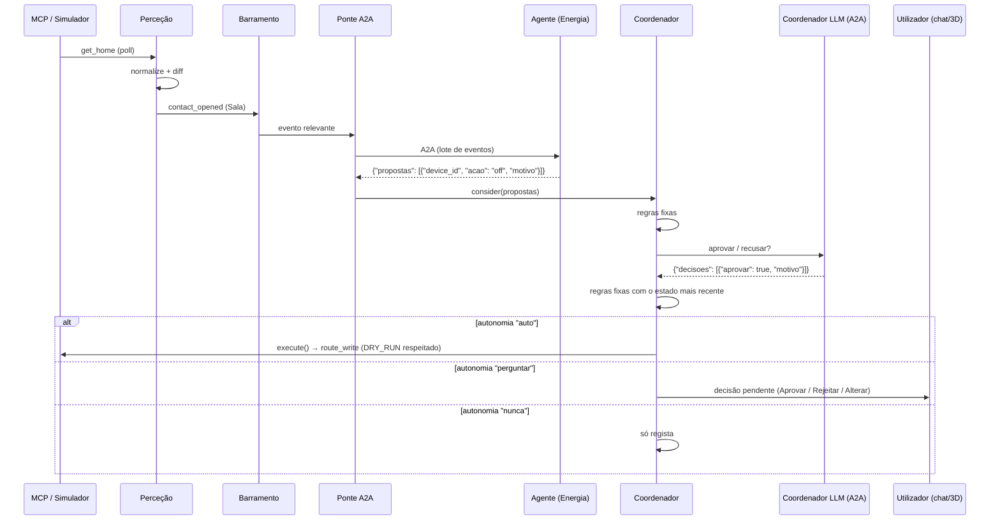

# Arquitetura

Visão de conjunto de como a casa percebe, decide e age. Para correr a aplicação, ver o [README](../README.md).

## Componentes

| Camada | Módulos | Responsabilidade |
|---|---|---|
| Fontes | `src/perception/sources.py`, `src/mcp_client.py`, `src/sim/home.py` | Ler a casa: MCP real, casa simulada, ou ambas. Só ferramentas de leitura. |
| Perceção | `src/perception/poller.py`, `src/perception/state.py` | A cada `POLL_INTERVAL_S` normaliza o `get_home` num `HomeState` e compara com o anterior para gerar `Event`s. Não chama o LLM. |
| Memória partilhada | `src/memory.py` | Último `HomeState`, eventos recentes e um barramento de eventos em processo. |
| Armazenamento | `src/storage/` | SQLite em `var/home.db`: `readings`, `events`, `decisions`. |
| Preferências | `src/prefs/` | Preferências versionadas e validadas com Pydantic. |
| Agentes | `src/agents/` | Servidores A2A (Coordenador, Segurança, Energia, Conforto) e a ponte que lhes envia eventos. |
| Coordenador | `src/coordinator.py`, `src/writes.py` | Único componente que escreve: guardrails → árbitro LLM → guardrails → `execute()` → `route_write()`. |
| Chat | `src/chat/` | Conversa com o utilizador: intenções, respostas, regras em linguagem natural, confirmações. |
| Sugestões | `src/insights/` | Detetores de padrões sobre o histórico, filtro anti-microgestão, agendamentos diários. |
| Visão | `src/vision/` | Captura RTSP/webcam e análise multimodal de frames. Ver [vision_architecture.md](vision_architecture.md). |
| Gémeo 3D | `src/twin/` | Layout da casa, edição (chat/arrasto/desfazer), estado e stream SSE. |
| API e UI | `src/api.py`, `src/ui/` | FastAPI; HTML/CSS/JS sem build; Three.js r160 local. |

## Fluxo de um evento



Pormenores do encaminhamento (`src/agents/bridge.py`):

- `route()` decide que agente quer que evento. O **fumo nunca é encaminhado**: é caminho de emergência.
- Há um worker por agente num loop asyncio em background; a perceção nunca espera por um LLM.
- Eventos próximos vão num só lote; o mesmo (tipo, divisão) não é reenviado ao mesmo agente antes de
  `AGENT_COOLDOWN_S`.

## O Coordenador

Entradas:

1. **Pedidos do utilizador** (`POST /coordinator/request`, botões do 3D, chat): executam logo, depois das regras fixas.
2. **Propostas dos agentes**: regras fixas → Coordenador LLM → regras fixas outra vez → autonomia → execução.
3. **Emergência**, sem LLM:
   - **fumo** → desliga as tomadas e põe a luz a vermelho;
   - **intrusão** (alarme disparado com a casa em Home ou Away) → luz vermelha no máximo; o estado anterior é
     reposto quando o alarme é cancelado.

Regras fixas: dispositivo conhecido e ação permitida, dispositivo online, não é já o estado atual, nada se liga
durante fumo, não se contraria uma ação recente de prioridade maior.

Prioridades: **Emergência > Utilizador > Segurança > Energia > Conforto**.

Cada resultado fica como `Decision` (`executed`, `pending`, `rejected`, `dry_run`, `vetoed`) em `var/home.db` e
aparece na linha do tempo e em balões sobre o dispositivo no 3D. **Porquê?** mostra o debate: proposta,
preferência citada e decisão.

`route_write()` envia a escrita para onde o dispositivo vive (`DeviceState.source`: `mcp` ou `sim`) e, com
`DRY_RUN=true`, devolve o plano sem escrever.

## Agentes LLM

| Agente | Porta | Papel |
|---|---|---|
| Coordenador | 9100 | Árbitro: aprova ou recusa cada proposta com um motivo |
| Segurança | 9101 | Portas, janelas, alarme, câmara |
| Energia | 9102 | Tomadas, consumos, desperdício |
| Conforto | 9103 | Temperatura, humidade, luz |

Cada um é um agente do **Microsoft Agent Framework** exposto por **A2A** (agent card + JSON-RPC) com o modelo de
`LLM_BASE_URL`/`LLM_MODEL`. As ferramentas (`src/agents/tools.py`) fazem só `GET` à API
(`/tools/consumo_por_hora`, `/tools/tendencia_temperatura`, `/tools/ultima_analise_camara`, …). Contexto enviado a
cada agente (`src/context.py`): estado das divisões envolvidas, tendência de 2 h, energia hoje/ontem, até 5 eventos
recentes e as preferências que se aplicam.

Formatos de resposta (`src/agents/specs.py`):

```json
{"resumo": "…", "propostas": [{"device_id": "…", "acao": "on|off", "motivo": "…"}]}
{"resumo": "…", "decisoes":  [{"n": 1, "aprovar": true, "motivo": "…"}]}
```

## Chat

`src/chat/service.py` é a única conversa do utilizador.

- Cada mensagem é classificada com output estruturado (LLM + Pydantic, `src/llm.py`). Se o LLM falhar, regras
  PT-PT (`src/chat/intents.py`) fazem o trabalho e completam campos em falta.
- Vários pedidos numa mensagem: o imediato executa logo; o que precisa de confirmação é perguntado um a um.
- Perguntas de estado são respondidas por modelos determinísticos (`src/chat/answers.py`): os números da resposta
  são exatamente os dos dados.
- **Regras** em linguagem natural viram um cenário `TT_…` no MCP (`post_new_scenario`, `src/chat/rules.py`). "Avisa-me"
  é feito localmente pelo `RuleWatcher`, porque o MCP não escreve no nosso chat.
- Agendamentos diários ("liga o aquecedor às 7h") correm localmente (`src/insights/scheduler.py`), porque os timers do
  MCP devolvem 404 nesta conta.
- **Nada é gravado antes de o utilizador confirmar** uma reformulação concreta
  ("Vou definir 21 °C no Quarto entre as 7h e as 9h. Confirmas?").

## Memórias

Tudo em SQLite local (`var/home.db`, ou `var/home_sim.db` com `SIMULATE=true`), modo WAL, uma ligação curta por
chamada para threads e processos partilharem o ficheiro.

| Tabela | Conteúdo |
|---|---|
| `readings` | A cada `STORE_INTERVAL_S`: `temperature`, `humidity`, `power_w`, `energy_today_kwh`, `energy_yesterday_kwh`, `open`, `on`, `battery` |
| `events` | Todos os eventos do barramento (exceto `tick`) |
| `decisions` | Gatilho, propostas, decisão, explicação, autonomia, estado e resposta do utilizador |
| `preferences` | Versionadas: alterar insere linha nova e desativa a anterior; revogar desativa; só "Apagar tudo" apaga |
| `meta` | Lease do escritor (se API e gravador correm juntos, só um grava) |

Chaves de preferência (`src/prefs/models.py`): `setpoint_c`, `comfort_range_c`, `humidity_max_pct`, `autonomy`,
`quiet_hours`, `rule`, `layout`, …; `source` é `explicit` ou `learned_confirmed`.

## Sugestões proativas

`src/insights/`: detetores em código → filtro → frase pelo LLM → verificação → chat.

- Detetores: `daily_pattern` (mesma métrica alta/baixa na mesma janela horária em ≥ `INSIGHT_MIN_DAYS` dias),
  `window_heater`, `standby`, `repeated_action`.
- Filtro: no máximo `INSIGHT_MAX_PER_DAY` por dia, nada em `quiet_hours` (exceto a pedido), só com ação possível com
  os dispositivos existentes, sugestões rejeitadas não se repetem durante algum tempo.
- **Porquê?** desenha o histórico real que originou a sugestão (`GET /insights/{id}/evidence`).

## Gémeo 3D

- `config/layout.json` diz **onde** estão as coisas (metros; dispositivos relativos ao canto da divisão). **O que**
  existe vem sempre do `get_home`: o que falta no layout aparece num sítio por omissão, nunca escondido.
- Alterações do utilizador (chat, arrasto em **Ajustar 3D**) ficam em `var/layout_user.json` e como preferência
  `layout`, com **Desfazer**.
- Janelas e portas editáveis pelo chat; o sensor de contacto vai com a abertura e é nomeado pelo que vigia
  ("porta" ou "janela").
- Tempo real por SSE (`/twin/stream`), com polling de 2 s como recurso.
- Para outra casa: `python scripts/layout_init.py --force`.

## Visão

Com `CAMERA_RTSP_URL` definido (e `opencv-python`), a API mantém o stream aberto e o 3D mostra-o
(`/vision/live.mjpg`). Eventos da câmara e alarmes com a casa armada enviam o frame atual ao modelo multimodal
(`VISION_MODEL`). Detalhe em [vision_architecture.md](vision_architecture.md).
