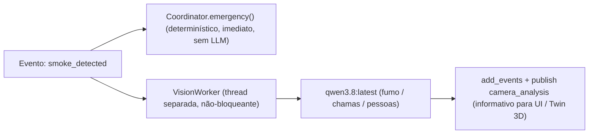

# Arquitetura Técnica — Módulo de Visão Computacional Local

**Projeto:** ATC Hackathon 2026 — Equipa 7 (Tico&Tech)  
**Estado:** Proposta arquitetural revista (pronta para branch `feat/camera-vision`, base `main` em `dc24481`)  
**Data:** 2026-11-18  

---

## 1. Objetivo e Princípios Arquiteturais

O módulo de visão acrescenta perceção visual à casa inteligente, capturando e analisando frames da câmara local em resposta a eventos de segurança e emergência (intrusão, manipulação e fumo).

O desenho segue estritamente as invariantes já estabelecidas no repositório:

1. **Separação Perceção vs. Raciocínio vs. Execução:**
   - **Visão (`src/vision/`, "Olhos"):** captura o frame e extrai **factos estruturados objetivos** (`VisionObservation`). Não toma decisões sobre atuadores nem substitui a narrativa do agente.
   - **Agente de Segurança (`src/agents/`, "Cérebro"):** cruza os factos visuais com o estado global da casa (modo armado, sensores, divisões) e gera o `resumo` final em PT-PT e as `propostas` (`AgentReply`).
   - **Coordenador (`src/coordinator.py`):** mantém-se o **único** componente autorizado a escrever em dispositivos (`allow_write=True`).
2. **Emergência determinística intocável:** em `smoke_detected`, a visão corre **sempre em paralelo e de forma não-bloqueante** — nunca atrasa nem cancela o protocolo determinístico `Coordinator.emergency()` ([coordinator.py](../src/coordinator.py#L176-L230)).
3. **Execução não-bloqueante na Perceção:** o `EventBus.publish()` ([memory.py](../src/memory.py#L28-L37)) é síncrono na thread de polling. Toda a captura de imagem e inferência corre numa worker thread dedicada.
4. **Suporte completo a `SIMULATE=true` e testes offline:** tal como `McpSource`/`SimSource` ([sources.py](../src/perception/sources.py)), tanto a fonte de imagem como o analisador usam interfaces (`Protocol`) substituíveis por implementações determinísticas em testes e demonstrações.

---

## 2. Contexto Atual do Sistema e Restrições Verificadas

### 2.1 Topologia da Casa ("Hack 7")

Confirmada em [get_home_rooms.json](capabilities/get_home_rooms.json) e [home.json](../config/home.json):

| Divisão | Fonte | Dispositivos | Tem câmara? |
|---|---|---|---|
| **Sala** | MCP real | `Camera`, `Security hub`, `Contact sensor`, `Smoke sensor` | **Sim** |
| **Quarto** | MCP real | `Light`, `Plug`, `Temperature sensor` | Não |
| **Cozinha** | Simulada (`config/home.json`) | `temperature`, `contact`, `plug` | Não |

> [!NOTE]
> Todos os sensores de segurança e emergência (contacto da janela/porta, hub, detetor de fumo) partilham a mesma divisão física da câmara (**Sala**). Ainda assim, o módulo de visão é *room-aware* para que eventos em divisões sem câmara (ex.: janela aberta na `Cozinha`) não disparem falsas associações com a câmara da `Sala`.

### 2.2 Limitações do MCP e Estado da Câmara

- Pelo dump real em [device_Camera_cf105207-a096-4ac1-a891-4a5a15023df6.json](capabilities/device_Camera_cf105207-a096-4ac1-a891-4a5a15023df6.json) e [tools_schema.json](capabilities/tools_schema.json), o MCP da Altice **não expõe vídeo nem snapshots** — apenas capabilities de estado (`motionDetected`, `soundDetected`, `motionAlarmSwitch`, etc.).
- A captura de frames ocorre fora do MCP, prevista em [.env.example](../.env.example#L16-L17) via `CAMERA_RTSP_URL`.
- **Estado atual:** a câmara física ainda não está acessível na rede local e `motionAlarmSwitch` aparece `false` no dump inicial. A arquitetura permite desenvolvimento, testes e demonstração imediatos via imagens locais (`FileFrameSource`) e fica pronta a ligar a RTSP (`RtspFrameSource`) assim que o stream estiver disponível.

### 2.3 Validação ao Vivo do Servidor Interno de Modelos

Foi efetuado um diagnóstico direto ao servidor configurado em [.env.example](../.env.example#L9-L14) (`http://192.168.2.161:1234`):

- **Servidor confirmado:** **Ollama** a escutar na porta `1234` (respondeu aos endpoints nativos `/api/ps` e `/api/show`, e expõe a API OpenAI-compatible em `/v1/models` e `/v1/chat/completions`).
- **Modelo residente em VRAM (`/api/ps`):** `qwen3.8:latest` — `27.36 GB` (100% em VRAM).
- **Capabilities verificadas (`/api/show`):** `['completion', 'vision', 'tools', 'thinking']` (`27.3B`, `Q4_K_M`).
- **Outros modelos multimodais instalados no servidor:** `gemma4:latest` (8.0B, `vision` + `audio`), `muse-glimmer:latest` (27.9B), `qwen3.6:35b` (36.0B), `llama4:scout` (108.6B).
- **Ensaio funcional de visão (`/v1/chat/completions`, `reasoning_effort="none"`):** envio de PNG sólido vermelho (`32x32`, base64) → **HTTP 200**, resposta `'Vermelho'` em **`7.63 s`**.
- **Suporte a `reasoning_effort="none"`:** já validado pela equipa neste mesmo servidor Ollama + `qwen3.8:latest` ([server.py](../src/agents/server.py#L42-L48), onde reduz respostas de texto de ~8–10 s para ~1 s) e aceite com HTTP 200 no ensaio visual.

> [!IMPORTANT]
> Reutilizar o **`qwen3.8:latest`** já carregado em VRAM elimina o risco de *model swapping* (descarregar/recarregar modelos de ~27 GB entre a visão e os agentes A2A) e dispensa dependências pesadas de ML (`torch`/`ultralytics`) no ambiente Python do projeto.

---

## 3. Decisões Arquiteturais

### 3.1 Motor de Visão Pluggable (`VisionAnalyzer`)

- **Implementação principal:** `OpenAIVisionAnalyzer` sobre `httpx` (já presente nas dependências), enviando o frame JPEG (redimensionado) em `data:image/jpeg;base64,...` para `VISION_BASE_URL` / `VISION_MODEL` (com fallback para `LLM_BASE_URL` / `LLM_MODEL`, `reasoning_effort="none"`, `temperature=0.0`, `max_tokens=500`).
- **Interface abstrata (`Protocol`):** caso venha a ser necessário reduzir latência para <150 ms (por exemplo, via YOLO/ONNX em CPU), basta adicionar uma nova implementação de `VisionAnalyzer` sem alterar `EventBus`, `AgentBridge`, `api.py` ou testes.
- **Implementação de testes:** `MockVisionAnalyzer` determinístico para `unittest`/`pytest`.

### 3.2 Padrão de Integração: Opção 1 (Enriquecimento Push + Consulta Pull)

Como a inferência visual no `qwen3.8:latest` demora vários segundos (~3–8 s) — acima da janela de agrupamento `BATCH_S = 1.5 s` definida em [bridge.py](../src/agents/bridge.py#L28) — disparar o `AgentBridge` em paralelo com a visão para eventos de câmara provocaria uma corrida (o Agente de Segurança responderia "às cegas" aos 1.5 s e voltaria a ser invocado após a análise visual).

Adota-se a **Opção 1 (Camada de Enriquecimento)** complementada por um endpoint de consulta *read-only*:

```mermaid
sequenceDiagram
    participant P as Perception (Poller)
    participant B as EventBus / SharedMemory
    participant V as VisionWorker (Thread)
    participant C as FrameSource (RTSP / File)
    participant M as qwen3.8:latest (:1234/v1)
    participant AB as AgentBridge (A2A)
    participant S as Agente Segurança (:9101)
    participant CO as Coordinator

    P->>B: Publica camera_motion (t=0.0s)
    B->>V: Notifica trigger (assíncrono via fila)
    Note over B,AB: Se VisionWorker aceita o evento e está vivo, AgentBridge adia camera_motion/camera_sound (com watchdog)
    V->>C: Captura frame imediato (t=0.1s)
    C-->>V: JPEG -> guarda em var/frames/
    V->>M: POST /v1/chat/completions (imagem + prompt factual)
    M-->>V: JSON estruturado (VisionObservation)
    V->>B: Guarda observação + add_events([camera_analysis]) + publish()
    B->>AB: Recebe camera_analysis (cancela watchdog; batch 1.5s)
    AB->>S: A2A JSON-RPC (factos visuais + estado da casa)
    S->>M: Raciocínio contextual (qwen3.8)
    M-->>S: AgentReply {resumo PT-PT, propostas}
    S-->>AB: Devolve AgentReply
    AB->>CO: Coordinator.consider() -> arbitra e regista decisão
```

#### Garantias de Resiliência e Comportamento em Paralelo

1. **Persistência em `SharedMemory` antes da publicação:** ao contrário dos eventos normais (que `Perception.step()` regista em `SharedMemory` antes de publicar), `camera_analysis` é um **evento sintético** gerado fora de `diff()`. Por isso, o `VisionWorker` executa **sempre** pela ordem:
   `memory.set_vision(obs)` → `memory.add_events([event])` → `bus.publish([event])`, garantindo que o evento aparece também no stream SSE do Twin 3D (`/twin/stream`).
2. **Fallback por erro de captura/inferência:** se a captura falhar (RTSP indisponível) ou a inferência der erro/timeout, o `VisionWorker` publica na mesma um `camera_analysis` com `status="capture_error" | "inference_error" | "timeout"`, garantindo que o Agente de Segurança acorda e decide pelos sensores convencionais.
3. **Watchdog + deteção de crash da thread (`AgentBridge`):**
   - O `AgentBridge` só difere `camera_motion` / `camera_sound` quando **ambas** as condições são verdadeiras: `vision_worker.will_handle(event, state)` é `True` **e** `vision_worker.is_alive()` é `True`. (Se a thread morreu, ou se o evento não dispara visão — ex. `camera_motion` em `DISARMED` — o routing cai de imediato no comportamento padrão.)
   - Para cada evento diferido, o `AgentBridge` agenda um **watchdog** de `VISION_TIMEOUT_S + 5 s`: se nenhum `camera_analysis` chegar dentro dessa janela (ex.: bloqueio inesperado do worker), o `AgentBridge` encaminha automaticamente o evento original para `"seguranca"` com nota de indisponibilidade da visão.
4. **Comportamento intencional em alarmes urgentes (`security_alarm`, `tamper_alarm`, `contact_opened` armado):**
   - Estes eventos **não** são atrasados pelo `AgentBridge`: o Agente de Segurança recebe-os de imediato (em `1.5 s`) para poder atuar sem esperar 3–8 s pela inferência visual.
   - Em paralelo, o `VisionWorker` captura e analisa o frame; quando publica `camera_analysis` segundos depois, o Agente de Segurança recebe a confirmação visual (pessoa + estado da janela) numa segunda invocação enriquecida. Esta dupla invocação em alarmes ativos é **intencional** (prioriza tempo de reação em intrusão confirmada por sensor de perímetro).

**Fluxo paralelo de emergência (`smoke_detected`):**



**Consulta Pull complementar (alinhada com [tools.py](../src/agents/tools.py)):**
- `GET /tools/ultima_analise_camara` em [api.py](../src/api.py) — lê a última `VisionObservation` em `SharedMemory` (~1 ms, sem nova inferência).
- `GET /vision/frames/{filename}` — serve de forma segura os snapshots guardados em `var/frames/` (validando nome de ficheiro contra *path traversal*) para a UI e o Twin 3D.
- `POST /vision/analyze` — trigger manual *on-demand* (útil para demonstrações, debug ou testes independentemente do modo de segurança).
- `@tool ultima_analise_camara` em [tools.py](../src/agents/tools.py) atribuída ao agente `"seguranca"`.

---

## 4. Política de Triggers, Modos de Segurança e Proteções

### 4.1 Matriz de Disparo (Modo da Casa × Evento)

Todos os triggers abaixo aplicam-se apenas quando o evento ocorre numa **divisão com câmara (`Sala`)** ou é um **evento global sem divisão** (`room is None`):

| Evento (`EventType`) | `AWAY` *(ausente)* | `STAY` *(em casa)* | `DISARMED` *(desarmada)* | Contexto de Prompt | Observações |
|---|---|---|---|---|---|
| **`security_alarm`** *(intrusão)* | **Sim** | **Sim** | **Sim** | `intrusion` | Confirmação visual imediata (pessoas + **estado da janela**). Não bloqueia envio imediato a `Segurança`. |
| **`tamper_alarm`** | **Sim** | **Sim** | **Sim** | `intrusion` | Manipulação física do hub ou sensor na `Sala` é anómala em qualquer modo. |
| **`contact_opened`** | **Sim** | **Sim** | **Não** | `intrusion` | Violação de perímetro armada; em `DISARMED` evita falsos disparos no `cenario janela`. |
| **`camera_motion`** | **Sim** | **Sim** | **Não*** | `intrusion` | Em `AWAY`: cooldown curto (`10 s`). Em `STAY`: cooldown mais longo (`30 s`). *Configurável em `DISARMED` via `VISION_TRIGGER_DISARMED=false`. |
| **`camera_sound`** | **Sim** | **Não** | **Não** | `intrusion` | Apenas em `AWAY` (evita disparos por TV/conversas quando há moradores em casa; se houver `security_alarm` em `STAY`, este já dispara a visão). |
| **`smoke_detected`** | **Sim** | **Sim** | **Sim** | `smoke` | **Não-bloqueante**; corre em paralelo com `Coordinator.emergency()`. Verifica fumo, chamas e pessoas em risco. |
| **Restantes eventos** (`temperature_*`, `humidity_*`, `plug_*`, `light_*`, `contact_closed`, `security_mode_changed`, `alarm_state_changed`, `hub_alarm`, `alarm_cancelled`, `device_*`, `tick`) | **Não** | **Não** | **Não** | — | Sem necessidade visual ou redundantes com `security_alarm`/`smoke_detected`. |

### 4.2 Proteções contra Rajadas e Interação entre Cooldowns

1. **Single-flight por divisão:** apenas **1** captura/inferência pode estar em curso por divisão de cada vez. Novos triggers que cheguem enquanto a análise está a decorrer são descartados, com uma exceção: um evento `smoke_detected` fica pendente (slot único) para correr imediatamente a seguir se a análise em curso for de prioridade inferior.
2. **Cooldown diferenciado da visão:**
   - Modo `AWAY` / alarmes (`security_alarm`, `tamper_alarm`, `contact_opened` armado): `VISION_COOLDOWN_S` (omissão: **`10 s`**). Garante que a rajada do `cenario intrusao` (`contact_opened` + `security_alarm` + `camera_motion` em 2 s) gera **1 única análise** em vez de 3.
   - Modo `STAY` em `camera_motion`: `VISION_STAY_COOLDOWN_S` (omissão: **`30 s`**) para reduzir ruído de circulação doméstica.
   - **Upgrade de prioridade:** `smoke_detected` fura o cooldown de uma análise anterior de movimento/intrusão.
3. **Interação com `AGENT_COOLDOWN_S = 60 s` em [bridge.py](../src/agents/bridge.py#L189-L195):**
   - O filtro `_recently_sent()` do `AgentBridge` **só** descarta eventos repetidos dentro de `60 s` quando **`event.severity == "info"`**; eventos com `severity` `"warning"` ou `"critical"` passam **sempre**.
   - Consequência benéfica: múltiplos falsos alarmes seguidos (`severity="info"`) continuam a ser registados em `SharedMemory`/timeline sem acordar repetidamente o Agente de Segurança, enquanto qualquer deteção real de risco (`has_person=True` armado, `window_or_door_open=True` armado, `smoke_or_fire_visible=True`, ou erro em modo armado → `warning`/`critical`) atravessa sempre o `AgentBridge`.
4. **Filtro *room-aware*:** eventos de divisões sem câmara (ex.: `contact_opened` na `Cozinha` simulada) não acionam a câmara da `Sala`.

---

## 5. Contratos de Dados e Prompting

### 5.1 Modelo Pydantic (`VisionObservation`)

Definido em `src/vision/models.py` como modelo **imutável** (`ConfigDict(frozen=True)`) para garantir *thread-safety* real em `SharedMemory`:

```python
class VisionObservation(BaseModel):
    model_config = ConfigDict(frozen=True)

    id: str
    ts: float
    room_id: str | None = None
    room_name: str = ""
    camera_id: str | None = None
    # camera_motion | camera_sound | security_alarm | contact_opened | tamper_alarm | smoke_detected | manual
    trigger_type: str
    trigger_event_id: str | None = None
    context: Literal["intrusion", "smoke", "general"]
    status: Literal["ok", "capture_error", "inference_error", "timeout"] = "ok"

    # Factos visuais objetivos (preenchidos quando status == "ok")
    has_person: bool = False
    person_count: int = 0
    category: Literal["person", "pet", "smoke_or_fire", "empty", "other", "unclear"] = "unclear"
    window_or_door_open: bool | None = None   # True=aberta, False=fechada, None=não visível/indeterminado
    smoke_or_fire_visible: bool = False
    objects: tuple[str, ...] = ()
    # Confiança global auto-avaliada pelo VLM na análise (0.0-1.0, não calibrada; indicador heurístico para agentes/UI)
    overall_confidence: float = Field(default=0.0, ge=0.0, le=1.0)
    scene_note_pt: str = ""                   # observação factual curta em PT-PT (máx. ~1 frase)

    # Metadados operacionais
    frame_path: str | None = None             # caminho relativo em var/frames/<nome>.jpg
    error: str | None = None
    model: str = ""
    latency_ms: int = 0
```

> [!TIP]
> **`scene_note_pt` vs. `AgentReply.resumo`:** o campo `scene_note_pt` é estritamente descritivo da imagem (*"Uma pessoa junto à janela aberta na sala"*), nunca contém decisões nem recomendações. O **`resumo`** final na timeline e as **`propostas`** continuam a ser gerados pelo Agente de Segurança em [specs.py](../src/agents/specs.py#L47-L53).

### 5.2 Prompts Especializados por Contexto

O analisador usa `temperature=0.0`, `reasoning_effort="none"`, **`max_tokens=500`** (margem de segurança caso o modelo emita tags `<think>` ou listas extensas de `objects`, evitando truncamento mid-JSON), exigindo resposta exclusivamente em JSON (com parser tolerante semelhante a `_json_candidates` em [specs.py](../src/agents/specs.py#L92-L124)):

- **Contexto `intrusion` (`camera_motion`, `camera_sound`, `contact_opened` armado, `security_alarm`, `tamper_alarm`):**
  - Foco explícito em:
    1. Detetar e contar **pessoas** (`has_person`, `person_count`);
    2. Distinguir falsos alarmes comuns (animais de estimação, cortinas/sombras, sala vazia);
    3. **Verificar visualmente a janela/porta** (`window_or_door_open`: aberta, fechada ou não visível no enquadramento) e sinais de acesso forçado;
    4. Descrever objetivamente em 1 frase curta PT-PT (`scene_note_pt`).
- **Contexto `smoke` (`smoke_detected`):**
  - Foco explícito em:
    1. Verificar presença visual de **fumo, neblina densa, chamas ou clarão** (`smoke_or_fire_visible`);
    2. Detetar e contar **pessoas na divisão** (`has_person`, `person_count`) para avaliar ocupantes em risco;
    3. Descrever objetivamente em 1 frase curta PT-PT (`scene_note_pt`).

### 5.3 Evento Sintético Publicado no `EventBus` (`camera_analysis`)

`camera_analysis` é um **evento sintético** (não produzido por `diff()` em `state.py`, mas registado previamente em `EventType` para validação Pydantic). O `VisionWorker` cria `Event(type="camera_analysis", ...)`:

- **`severity`:**
  - `"critical"`: `smoke_or_fire_visible == True`, ou `has_person == True` com casa armada (`AWAY`/`STAY`), ou `trigger_type == "smoke_detected"` com pessoa presente.
  - `"warning"`: `window_or_door_open == True` com casa armada, ou `status != "ok"` durante alarme/modo armado, ou `category == "unclear"` com casa armada, ou qualquer análise acionada por `security_alarm`/`tamper_alarm` *(garante também que não é filtrada pelo cooldown de 60 s do `AgentBridge`)*.
  - `"info"`: falso alarme confirmado (`empty`/`pet` sem janela aberta em `camera_motion`), casa desarmada sem perigo, ou verificação manual normal.
- **`message` (PT-PT determinística para a timeline):** ex. `"Análise visual da Sala: 1 pessoa detetada, janela aberta (90%)."` ou `"Análise visual da Sala: sem pessoas nem fumo visível (falso alarme provável)."`
- **`data`:** `observation.model_dump()` completo, consumível diretamente pelo `build_prompt` em [bridge.py](../src/agents/bridge.py#L79-L94) e pelo Twin 3D.

---

## 6. Estratégia de Captura de Frame (`FrameSource`)

Definida em `src/vision/capture.py` através de um `Protocol`:

```python
class FrameSource(Protocol):
    name: str
    def capture(self, room_id: str | None = None) -> bytes: ...  # JPEG bytes
```

Três implementações suportadas:

| Implementação | Quando é usada | Comportamento |
|---|---|---|
| **`FileFrameSource`** | `SIMULATE=true`, testes unitários, ou quando `CAMERA_RTSP_URL` está vazio | Lê uma imagem configurável (`VISION_SIM_IMAGE` ou imagens por cenário em `tests/fixtures/` / `var/`). Permite testar cenários distintos (intruso + janela aberta, animal, fumo, sala vazia) de forma determinística. |
| **`RtspFrameSource`** | `CAMERA_RTSP_URL` preenchido (ex.: `rtsp://user:pass@ip:554/...`) | Captura via OpenCV ou `ffmpeg` (subprocesso), com timeout curto, *flush* de buffer (ou thread leitora de último frame fresco para evitar frames antigos presos no buffer RTSP), reconexão automática e redimensionamento para largura máx. `768–1024 px` em JPEG (qualidade ~80). |
| **`WebcamFrameSource`** | Opcional (`CAMERA_RTSP_URL=webcam:0`) | Fallback local rápido para demonstrações ao vivo com webcam USB/portátil caso a câmara física não esteja acessível na rede do evento. |

> [!WARNING]
> **Nota sobre OpenCV em Windows (RTSP / Webcam):** validar na máquina de demo se `opencv-python-headless` abre corretamente `cv2.VideoCapture(0, cv2.CAP_DSHOW)` em Windows; caso haja incompatibilidade com o backend de vídeo local, usar `opencv-python` (ou `ffmpeg` em alternativa) e manter a importação **lazy** dentro de `RtspFrameSource`/`WebcamFrameSource` para que os testes offline e `FileFrameSource` não dependam de OpenCV.

**Gestão de snapshots em disco (`var/frames/`):**
- Cada frame capturado é gravado em `var/frames/<YYYYMMDD_HHMMSS>_<room>_<id>.jpg` (`var/` já está no `.gitignore`).
- Política de retenção simples (manter apenas os últimos `VISION_MAX_FRAMES = 50` ficheiros) para evitar crescimento ilimitado em disco.

---

## 7. Mapa de Ficheiros e Configuração

### 7.1 Novos Ficheiros (isolados em `src/vision/`)

- `src/vision/__init__.py`
- `src/vision/models.py` — `VisionObservation` (`frozen=True`) e helpers de formatação PT-PT.
- `src/vision/capture.py` — `FrameSource`, `FileFrameSource`, `RtspFrameSource`, `WebcamFrameSource`, redimensionamento e persistência com retenção em `var/frames/`.
- `src/vision/analyzer.py` — `VisionAnalyzer`, `OpenAIVisionAnalyzer` (cliente `httpx` para `/v1/chat/completions`, `max_tokens=500`), prompts `intrusion`/`smoke`, parser JSON tolerante, `MockVisionAnalyzer`.
- `src/vision/worker.py` — `VisionWorker` (regras *room-aware*, matriz de triggers, `will_handle()`, `is_alive()`, cooldown/single-flight, worker thread dedicada, `memory.set_vision` + `memory.add_events` + `bus.publish` com fallback garantido).
- `tests/test_vision.py` — cobertura unitária completa (matriz de triggers em `AWAY`/`STAY`/`DISARMED`, cooldown, upgrade de `smoke_detected`, interação com cooldown de 60 s do `AgentBridge`, watchdog/fallback em crash ou erro, parsing JSON com `<think>`, integração com API).

### 7.2 Alterações Cirúrgicas em Ficheiros Existentes

| Ficheiro | Alteração prevista (mínima) |
|---|---|
| [src/config.py](../src/config.py) & [.env.example](../.env.example) | Adicionar variáveis `VISION_*` e `CAMERA_RTSP_URL` a `Settings`. |
| [src/perception/state.py](../src/perception/state.py) | Acrescentar `"camera_analysis"` ao `Literal` `EventType` (documentado como evento sintético; `diff()` não o emite). |
| [src/memory.py](../src/memory.py) | Métodos thread-safe `set_vision(obs)` e `latest_vision(room=None)` em `SharedMemory` (sobre `VisionObservation` imutável). |
| [src/agents/bridge.py](../src/agents/bridge.py) | Adicionar `"camera_analysis"` a `SECURITY_EVENTS`; diferir `camera_motion`/`camera_sound` apenas quando `vision_worker.will_handle(...) and vision_worker.is_alive()`, com watchdog de `VISION_TIMEOUT_S + 5 s`; incluir detalhes estruturados de `camera_analysis` em `build_prompt()`. |
| [src/agents/specs.py](../src/agents/specs.py) | Pequeno ajuste nas instruções do agente `"seguranca"` para considerar `camera_analysis` (pessoas, falsos alarmes, janela aberta). |
| [src/agents/tools.py](../src/agents/tools.py) | Registar `@tool ultima_analise_camara` (read-only) em `TOOLS_BY_AGENT["seguranca"]`. |
| [src/api.py](../src/api.py) | Instanciar e arrancar `VisionWorker` quando `settings.vision_enabled`; subscrever explicitamente `bus.subscribe(vision_worker.on_event, types=VISION_TRIGGER_EVENTS)` (a par de `coordinator.on_event`); adicionar `GET /tools/ultima_analise_camara`, `GET /vision/frames/{filename}` e `POST /vision/analyze`. |
| [src/twin/state.py](../src/twin/state.py) | Mapear `"camera_analysis": "Segurança"` em `AREA_BY_EVENT`. |

### 7.3 Variáveis de Ambiente Propostas

```env
# --- Visão / Câmara ---
VISION_ENABLED=true
CAMERA_RTSP_URL=                    # vazio = usa FileFrameSource (simulação); rtsp://... ou webcam:0
VISION_BASE_URL=                    # vazio = herda LLM_BASE_URL
VISION_MODEL=                       # vazio = herda LLM_MODEL (qwen3.8:latest)
VISION_API_KEY=                     # vazio = herda LLM_API_KEY
VISION_TIMEOUT_S=45                 # margem para cold-start (~30 s); quente ~1,6 s
VISION_KEEP_ALIVE=30m               # mantém o modelo em VRAM no Ollama (vazio = não aquecer)
VISION_WARMUP=true                  # pré-carrega o modelo em background ao arrancar a API
VISION_COOLDOWN_S=10                # cooldown padrão (AWAY e alarmes)
VISION_STAY_COOLDOWN_S=30           # cooldown para camera_motion em STAY
VISION_TRIGGER_DISARMED=false       # true apenas para testes/demos rápidas sem armar a casa
VISION_SIM_IMAGE=                   # opcional: caminho de imagem para FileFrameSource
VISION_MAX_FRAMES=50                # retenção máxima de snapshots em var/frames/
VISION_FRAMES_DIR=                  # vazio = var/frames/ (gitignored)
```

---

## 8. Plano de Validação e Pontos a Alinhar com a Equipa

### 8.1 Critérios de Aceitação (antes de merge em `main`)

1. **Suite offline (`pytest` / `unittest`):** todos os testes existentes + `tests/test_vision.py` a passar sem rede nem câmara física.
2. **Ensaio real contra `192.168.2.161:1234/v1` (`qwen3.8:latest`) em `SIMULATE=true`:**
   - `cenario intrusao` com imagem de pessoa + janela aberta → 1 única captura, `has_person=True`, `window_or_door_open=True`, Agente de Segurança propõe dissuasão com contexto visual.
   - `cenario intrusao` com imagem vazia / animal → `has_person=False`, Agente de Segurança identifica provável falso alarme.
   - `cenario fumo` → `Coordinator.emergency()` atua de imediato (0 atraso) e `VisionWorker` publica confirmação visual em paralelo.
   - `cenario janela` (`DISARMED`) → **0 chamadas** ao módulo de visão.
   - Falha simulada na captura / timeout / crash do worker → fallback (`camera_analysis` de erro ou watchdog no `AgentBridge`) garante notificação ao Agente de Segurança.

### 8.2 Pontos Pendentes com a Equipa

- [ ] **Acesso RTSP à câmara física:** confirmar se a câmara da Altice expõe RTSP na rede do hackathon (credenciais + IP) ou se na demo se usará `WebcamFrameSource` / `FileFrameSource`.
- [ ] **Capacidade `motionAlarmSwitch` da câmara real:** confirmar se ativar `motionAlarmSwitch=true` na app/MCP faz `motionDetected` atualizar em tempo real durante o polling.
- [ ] **UI / Gémeo Digital 3D:** confirmar com quem mantém `src/ui/` se quer exibir a miniatura do snapshot (`/vision/frames/{filename}`) na linha do tempo ou no painel do dispositivo `Camera` (o backend deixará o endpoint pronto desde logo).
- [ ] **Nome da branch:** `feat/camera-vision` criada a partir de `main` quando a equipa validar este documento.
